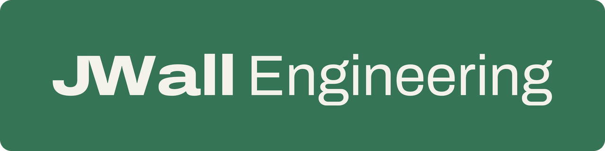

[](https://github.com/JWall-Engineering)

# jwall-engineering-branding

[](https://github.com/JWall-Engineering/jwall-engineering-branding/releases/latest)
[](https://github.com/JWall-Engineering/jwall-engineering-branding/actions/workflows/ci.yml)
[](https://github.com/JWall-Engineering/jwall-engineering-branding/blob/main/LICENSE)

The JWall Engineering brand in one place: the wordmark and the JW monogram,
the logo, the avatar for the organization and its GitHub Apps, the banner
every JWall Engineering README opens with, the social preview, the favicons
for [jwall.engineering](https://jwall.engineering), and the standard for
README headers. It is part of [JWall Engineering](https://jwall.engineering).
Other repositories and the site link to the files here instead of copying
them, so a change to the brand reaches every one of them without a pull
request.

## Assets

Every path below is **published**: other repositories and the site link to
it on `main`, so it is never moved, renamed or removed. What is drawn at a
path can change freely.

| Asset | Path | Size | Used for |
|---|---|---|---|
| Logo | [`assets/logo/jwall-engineering-logo.png`](assets/logo/jwall-engineering-logo.png) | 1024 × 1024, transparent | Anywhere that supplies its own background, light or dark |
| Avatar | [`assets/avatar/jwall-engineering-avatar.png`](assets/avatar/jwall-engineering-avatar.png) | 1024 × 1024, Green background | The `JWall-Engineering` organization picture, and the logo of each of its GitHub Apps: JWall Engineering Releases, Comments, Upgrades and Deployments |
| README banner | [`assets/banner/jwall-engineering-readme-banner.png`](assets/banner/jwall-engineering-readme-banner.png) | 1280 × 320 | The first line of every JWall Engineering README, and the organization profile |
| Social preview | [`assets/social/jwall-engineering-social-preview.png`](assets/social/jwall-engineering-social-preview.png) | 1280 × 640, opaque | Each repository's social preview image (Settings → General → Social preview) |
| Favicon | [`assets/favicon/jwall-engineering-favicon-32.png`](assets/favicon/jwall-engineering-favicon-32.png) | 32 × 32 | The site's browser tab icon |
| Favicon | [`assets/favicon/jwall-engineering-favicon-64.png`](assets/favicon/jwall-engineering-favicon-64.png) | 64 × 64 | The same icon for high-density screens |
| Favicon | [`assets/favicon/jwall-engineering-favicon-180.png`](assets/favicon/jwall-engineering-favicon-180.png) | 180 × 180 | The Apple touch icon, for home screens and bookmarks |

The raw URL of any asset is
`https://raw.githubusercontent.com/JWall-Engineering/jwall-engineering-branding/main/<path>`.

The avatar keeps the monogram well inside the circle GitHub crops avatars
to: `scripts/render.py` refuses to draw it if the monogram's corners reach
past 80% of the circle's radius. When a GitHub App asks for a badge
background color, use Green, `#367456`.

To use the favicons on the site, link them from its `<head>`:

```html
<link rel="icon" type="image/png" sizes="32x32" href="https://raw.githubusercontent.com/JWall-Engineering/jwall-engineering-branding/main/assets/favicon/jwall-engineering-favicon-32.png">
<link rel="icon" type="image/png" sizes="64x64" href="https://raw.githubusercontent.com/JWall-Engineering/jwall-engineering-branding/main/assets/favicon/jwall-engineering-favicon-64.png">
<link rel="apple-touch-icon" sizes="180x180" href="https://raw.githubusercontent.com/JWall-Engineering/jwall-engineering-branding/main/assets/favicon/jwall-engineering-favicon-180.png">
```

## README headers

Every JWall Engineering repository's README opens with the same three
parts, in this order:

1. **The shared banner**, linked to the organization. Link to it; never copy
   it into the repository, or a change to the brand will not reach it.
2. **The repository's name** as the only level-one heading.
3. **The repository's own badges**, one per line in a single paragraph. Which
   badges a repository shows is its own choice. Use
   [shields.io](https://shields.io) badges in the default flat style, or the
   GitHub Actions badge for CI, and put them in this order where they apply:
   package or registry version, release, CI, license, then anything else the
   repository adds.

Then one paragraph that says what the repository is, linking to
[JWall Engineering](https://jwall.engineering).

Copy this block and replace `<repo>` and the badges:

```markdown
[](https://github.com/JWall-Engineering)

# <repo>

[](https://github.com/JWall-Engineering/<repo>/releases/latest)
[](https://github.com/JWall-Engineering/<repo>/actions/workflows/ci.yml)
[](https://github.com/JWall-Engineering/<repo>/blob/main/LICENSE)

What this repository is, in one paragraph. It is part of [JWall Engineering](https://jwall.engineering).
```

The banner and badges use Markdown image syntax with absolute URLs, not HTML
or relative paths, so every place that renders a README (GitHub, package
registries, mirrors) shows the header the same way.

## Palette and type

| Name | Hex | Use |
|---|---|---|
| Green | `#367456` | The ground of the avatar, the favicons, the banner and the social preview, and the color of the logo |
| Chalk | `#F4F2EA` | The letters on Green: the wordmark and the monogram |
| Brass | `#E9D18B` | The site's address under the wordmark on the social preview |

Green is dark enough for Chalk letters (4.9:1) and light enough to stand
apart from GitHub's dark theme (3.4:1) as well as from white (5.5:1), so the
transparent logo reads on both themes. It also stays clear of the warm paper
of Jaws, the teal of Pi and the blue of Braveheart.

The mark is typographic, set in one family,
[Archivo](https://fonts.google.com/specimen/Archivo) by Omnibus-Type, whose
width and weight axes give it two settings:

- **The wordmark** is one line: **JWall** fully expanded and extra bold
  (width 125, weight 800), broad, low and solid like a wall, then
  **Engineering** at normal width and regular weight (width 100, weight 400).
  The site's address is set like Engineering.
- **The monogram**, JW, is the wordmark's first two letters, set exactly as
  they are there. The J sits 0.10 em closer to the W than the font spaces
  them, so the J's stem and the W's first stroke fuse at the top and the
  initials read as one piece. It stands in for the wordmark wherever the
  space is square: the logo, the avatar and the favicons.

The variable font is `fonts/Archivo-Variable.ttf`, from Google Fonts, under
the SIL Open Font License in `fonts/Archivo-OFL.txt`.

## Changing the brand

Every asset is drawn by [`scripts/render.py`](scripts/render.py) from
[`source/brand.toml`](source/brand.toml), which holds the names, the type
settings and the palette, and the font in `fonts/`. To change one, edit the
definition or the script and render again:

```sh
uv run scripts/render.py           # writes every asset
scripts/check.sh                   # the same checks as CI
```

CI fails when a published path is missing or has the wrong size, and when a
committed asset no longer matches what the script draws. A redrawn asset is
a `feat`; moving or removing a published path is a breaking change (`feat!`)
and needs every repository that links to it updated first. Look at a redrawn
asset on GitHub's light and dark themes before opening the pull request.

## License

Everything here, the artwork included, is MIT licensed; see
[LICENSE](LICENSE). The font keeps its own SIL Open Font License.

Contribution rules are in [CONTRIBUTING.md](CONTRIBUTING.md); the rules for
coding agents are in [AGENTS.md](AGENTS.md).
